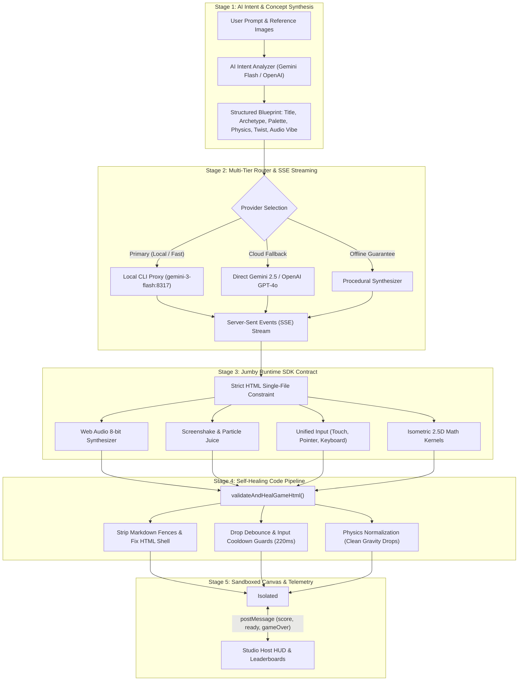

<div align="center">

# ⚡ Jumby

**The TikTok of Micro-Games — Play, Create, Remix, and Share in Seconds.**

[](https://nextjs.org/)
[](https://www.typescriptlang.org/)
[](https://tailwindcss.com/)
[](LICENSE)

*Generate hyper-engaging, addictive 60fps HTML5 canvas micro-games from natural language prompts, complete with procedural 8-bit audio, screenshake juice, dynamic level pacing, and self-healing runtime guarantees.*

</div>

---

## 📖 Table of Contents

- [Overview](#-overview)
- [Core Features](#-core-features)
- [Game Generation Architecture](#-game-generation-architecture)
  - [1. AI Intent & Concept Synthesis](#1-ai-intent--concept-synthesis)
  - [2. Multi-Tier Router & SSE Streaming](#2-multi-tier-router--sse-streaming)
  - [3. Jumby Runtime Contract & SDK](#3-jumby-runtime-contract--sdk)
  - [4. Self-Healing Code Pipeline](#4-self-healing-code-pipeline)
  - [5. Sandboxed Execution & Telemetry](#5-sandboxed-execution--telemetry)
- [Supported Game Archetypes](#-supported-game-archetypes)
- [Tech Stack](#-tech-stack)
- [Project Structure](#-project-structure)
- [Getting Started](#-getting-started)
- [Environment Configuration](#-environment-configuration)
- [API Reference](#-api-reference)
- [Contributing & License](#-contributing--license)

---

## 🌟 Overview

**Jumby** brings the instant gratification of vertical video feeds to interactive web games. Users swipe through a feed of community-created micro-games, remix them with a single click, or type a creative prompt (e.g. *"neon sushi balance on a moving cyberpunk train"*) to synthesize a brand-new, fully playable game in seconds.

Each game runs as a self-contained, lightweight HTML5 Canvas micro-app inside an isolated sandbox, leveraging the shared **Jumby Runtime SDK** (`window.Jumby`) for zero-asset procedural 8-bit sound, arcade screenshake, particle explosions, floating text, and unified touch/keyboard controls.

---

## ✨ Core Features

- **🎮 TikTok-Style Game Feed**: Swipe vertically through an infinite feed of instant micro-games with smooth hot-swapping and zero load latency.
- **⚡ AI Game Synthesis**: Generate complete, single-file HTML5 canvas games from raw prompts or sketches in under 4 seconds via local or cloud LLMs.
- **🧠 Intelligent Intent Extraction**: Deep semantic understanding of game concepts — automatically calibrating game archetypes, custom color palettes, physics constants (speed/gravity), typography, and unique mechanic twists.
- **🛡️ Self-Healing Code Pipeline**: Automated AST and pattern patchers inspect AI-generated code before mounting, fixing unclosed tags, input debounce issues, touch coordinate offsets, and 3D isometric gravity drop physics.
- **🎼 Zero-Asset Procedural Audio**: Built-in 8-bit Web Audio synthesizer generates jumps, laser zaps, score pings, coin chimes, fanfares, and looping procedural BGM vibes (`arcade`, `cyber`, `chill`, `action`) without external audio CDNs.
- **🎨 Visual Fine-Tuning Studio**: Real-time parameter controls for speed multipliers, gravity, custom hex palettes, Google Web Fonts, and mobile (9:16) vs. desktop (16:9) viewport previewing.
- **🔄 Instant Remixing**: Iterate on existing games by passing previous code as `baseCode`, allowing users to tweak mechanics, reskin themes, or add new features.

---

## 🏗️ Game Generation Architecture

The Jumby game generation engine runs an end-to-end 5-stage pipeline:



### 1. AI Intent & Concept Synthesis
- **Source**: [`src/lib/ai/intent-analyzer.ts`](src/lib/ai/intent-analyzer.ts) & [`src/app/api/intent/route.ts`](src/app/api/intent/route.ts)
- Analyzes prompts with high-speed LLM inference to extract:
  - **Arcade Title & Tagline**: Catchy names fitting the theme (e.g. `Neon Crust Cruiser`).
  - **Mechanical Archetype**: Maps intent to the optimal mechanic (`stack`, `runner`, `flappy`, `catcher`, `shooter`, `breakout`, `orbit`).
  - **Thematic Color Palette**: Hex values for player entities, neon accents, and dark canvas backgrounds.
  - **Calibrated Physics**: Speed multipliers (0.8x to 2.2x), gravity, and friction curves.
  - **Typography Vibe**: Google Web Font matching (e.g. *Orbitron*, *Press Start 2P*, *Fredoka*, *Space Grotesk*).
  - **Collectible & Twist**: Bespoke collectible item and unique gameplay hook.
- Synchronizes with the Studio UI in real-time over SSE so sliders, titles, and color pickers update live before code finishes streaming.

### 2. Multi-Tier Router & SSE Streaming
- **Source**: [`src/app/api/generate/route.ts`](src/app/api/generate/route.ts)
- Dispatches generation requests through a resilient waterfall:
  1. **Local CLI Proxy API**: Connects to `http://127.0.0.1:8317` with `gemini-3-flash` for instant, local token streaming.
  2. **External Cloud Models**: Direct fallback to Google Gemini (`gemini-2.5-flash`) or OpenAI (`gpt-4o-mini`).
  3. **Procedural Fallback Engine**: Deterministic procedural generator ensuring zero blank screens or network failures.
- Streams real-time progress milestones (`🧠 AI Intent`, `⚡ Synthesizing mechanics...`) and code tokens using Server-Sent Events.

### 3. Jumby Runtime Contract & SDK
- **Source**: [`src/lib/ai/runtime-contract.ts`](src/lib/ai/runtime-contract.ts) & [`public/jumby-runtime.js`](public/jumby-runtime.js)
- Enforces a strict runtime contract for generated games:
  - `Jumby.ready()`: Signals host that canvas is mounted.
  - `Jumby.setScore(score)`: Dispatches score to the parent HUD and evaluates dynamic difficulty / level-up banners.
  - `Jumby.gameOver(score)`: Triggers game over sequence and revives.
  - `Jumby.sound.*`: Procedural audio tones (`jump`, `score`, `hit`, `coin`, `laser`, `powerup`, `fanfare`, `bgm.start('arcade' | 'cyber' | 'chill' | 'action')`).
  - `Jumby.fx.*`: Particle bursts (`fx.particles()`), screenshake (`fx.shake()`), and popup floating scores (`fx.addFloatingText()`).
  - `Jumby.input.*`: Universal input normalizer handling touches, clicks, and keyboard strokes (`isDown`, `justPressed`, `touchPos`).

### 4. Self-Healing Code Pipeline
- **Source**: [`src/lib/ai/game-healer.ts`](src/lib/ai/game-healer.ts)
- Automatically intercepts and cures common LLM anomalies before mounting:
  - **Markdown Cleanup**: Strips conversational text and ```html fences.
  - **HTML Shell Validation**: Injects missing `<!DOCTYPE html>`, viewport meta tags, and `<script src="/jumby-runtime.js"></script>`.
  - **Multi-Tap Debounce Guard**: Enforces drop cooldowns (220ms) and restart delays (250ms) to eliminate instant double-drop death.
  - **Isometric Physics Normalization**: Replaces 2D canvas matrix rotation on isometric 3D debris with true downward gravity drops (`d.y -= d.vy`), eliminating perspective warping.

### 5. Sandboxed Execution & Telemetry
- **Source**: [`src/app/create/page.tsx`](src/app/create/page.tsx)
- Embeds games into an isolated `<iframe>` (`sandbox="allow-scripts allow-pointer-lock"`).
- Bidirectional `postMessage` protocol keeps host UI in sync with active gameplay, sound mute toggles, and high-score states.

---

## 🕹️ Supported Game Archetypes

| Archetype | Key Mechanics | Visual / Physics Focus |
| :--- | :--- | :--- |
| **Stack Tower** | Ketchapp-style block stacker & slicer | True 3D isometric projection, camera lerp, precision drop cooldowns |
| **Endless Runner** | Multi-lane hurdle dodging | High-speed scrolling, swipe/arrow lane shifts, accelerating difficulty |
| **Flappy / Hopper** | Tap-to-flap gravity physics | Sine wave motion, gap obstacles, forgiving bounding boxes |
| **Catcher** | Collecting falling items / dodging hazards | Smooth horizontal touch tracking, spawn frequency waves, particle bursts |
| **Wave Shooter** | Space invaders / laser blaster | Rapid projectile pools, enemy wave banners, explosion FX |
| **Breakout / Paddle** | Ball bouncing & brick clearing | Angle deflection physics, procedural brick grid generation |
| **Orbital Pulse** | Centripetal timing & rhythm hops | Radial orbit rotation, circular hit tests, zen/lo-fi audio |
| **Custom** | Freeform AI-synthesized mechanics | Bespoke rule combinations guided by LLM semantic reasoning |

---

## 💻 Tech Stack

- **Framework**: [Next.js 16](https://nextjs.org/) (App Router, Turbopack, React 19)
- **Language**: [TypeScript](https://www.typescriptlang.org/) (Strict typing across API routes and runtime SDK)
- **Styling**: [Tailwind CSS](https://tailwindcss.com/) with Lucide Icons
- **AI Models & Orchestration**:
  - Gemini 3 Flash / Gemini 2.5 Flash via CLI Proxy or Google GenAI SDK
  - OpenAI GPT-4o / GPT-4o-mini
  - Procedural dynamic synthesis engines
- **Audio Engine**: Web Audio API (procedural oscillator nodes, noise generators, gain curves)
- **Runtime Sandboxing**: HTML5 Canvas inside sandboxed browser iframes

---

## 📁 Project Structure

```
jumby/
├── public/
│   ├── games/                  # Pre-baked golden archetypes
│   │   ├── stack-tower/        # Reference isometric stacker engine
│   │   └── ...
│   ├── jumby-runtime.js        # Platform SDK (Audio, FX, Input, Telemetry)
│   └── sprites/                # Vector sprite sheets (coins, explosions)
├── src/
│   ├── app/
│   │   ├── api/
│   │   │   ├── generate/       # SSE game streaming route
│   │   │   ├── intent/         # AI intent & concept extraction route
│   │   │   └── publish/        # Game saving & publishing route
│   │   ├── create/             # Studio creation interface & live preview
│   │   ├── globals.css         # Tailwind base styles & color tokens
│   │   ├── layout.tsx          # Root application layout
│   │   └── page.tsx            # Main swipeable TikTok-style game feed
│   └── lib/
│       ├── ai/
│       │   ├── intent-analyzer.ts # Semantic concept & blueprint extractor
│       │   ├── game-healer.ts     # Self-healing code validator & patcher
│       │   ├── runtime-contract.ts# System prompt & Jumby SDK definitions
│       │   └── smart-generator.ts # Procedural fallback generator
│       └── templates/
│           └── game-generator.ts  # Pre-compiled HTML game generators
├── package.json
└── tsconfig.json
```

---

## 🚀 Getting Started

### Prerequisites

- [Node.js](https://nodejs.org/) (v18.18.0 or higher recommended)
- [pnpm](https://pnpm.io/) (v9 or higher)

### Installation

1. Clone the repository:
   ```bash
   git clone https://github.com/Ayushjain2205/jumby.git
   cd jumby
   ```

2. Install dependencies:
   ```bash
   pnpm install
   ```

3. Configure environment variables (see below):
   ```bash
   cp .env.example .env.local
   ```

4. Run the development server:
   ```bash
   pnpm dev
   ```

5. Open [http://localhost:3000](http://localhost:3000) in your browser.

---

## ⚙️ Environment Configuration

Create a `.env.local` file in the root directory:

```env
# Local CLI Proxy API (Default for local high-speed token generation)
CLI_PROXY_URL=http://127.0.0.1:8317
CLI_PROXY_KEY=123456
CLI_PROXY_MODEL=gemini-3-flash

# Cloud AI Providers (Optional - used as fallback if CLI proxy is offline)
GEMINI_API_KEY=your_google_gemini_api_key
OPENAI_API_KEY=your_openai_api_key

# Public Platform Configuration
NEXT_PUBLIC_APP_URL=http://localhost:3000
```

> **Note**: If neither local proxy nor cloud API keys are provided, Jumby automatically falls back to its offline **Procedural Synthesis Engine**, allowing complete local testing with zero setup.

---

## 📡 API Reference

### 1. `POST /api/intent`
Extracts a structured game design blueprint from a natural language prompt.

**Request Body:**
```json
{
  "prompt": "retro 80s neon pizza delivery motorcycle dodging crazy taxis",
  "requestedArchetype": "runner"
}
```

**Response:**
```json
{
  "intent": {
    "title": "Neon Crust Cruiser",
    "tagline": "Deliver hot pizza through cyberpunk traffic!",
    "archetype": "runner",
    "gameplayLoop": "Steer your motorcycle to deliver pizzas while dodging taxis.",
    "theme": "80s Outrun Cyberpunk",
    "themeColor": "#FF007F",
    "accentColor": "#00FFFF",
    "bgColor": "#0A0015",
    "fontVibe": "cyber",
    "speedMultiplier": 1.6,
    "gravity": 0.4,
    "soundVibe": "cyber",
    "collectibleItem": "🍕 Hot Pepperoni",
    "mechanicTwist": "Speed boosts accumulate with every successful delivery!"
  }
}
```

---

### 2. `POST /api/generate`
Streams the full HTML5 canvas micro-game over Server-Sent Events (SSE).

**Request Body:**
```json
{
  "prompt": "Cyberpunk stack tower with synthwave bass",
  "archetype": "stack",
  "baseCode": "optional string for remix mode",
  "targetDevice": "mobile"
}
```

**SSE Event Stream:**
```
data: {"step":"🧠 AI Intent: \"Neon Stack Surge\" (Cyberpunk)","intent":{...}}
data: {"step":"⚡ Synthesizing stack mechanics & juice..."}
data: {"chunk":"<!DOCTYPE html>..."}
data: {"done":true,"fullHtml":"<!DOCTYPE html>...","issuesFixed":["Added debounce guard"]}
```

---

## 🤝 Contributing & License

Contributions, bug reports, and game archetype PRs are welcome! Please feel free to open issues or submit pull requests.

This project is licensed under the **MIT License**.
